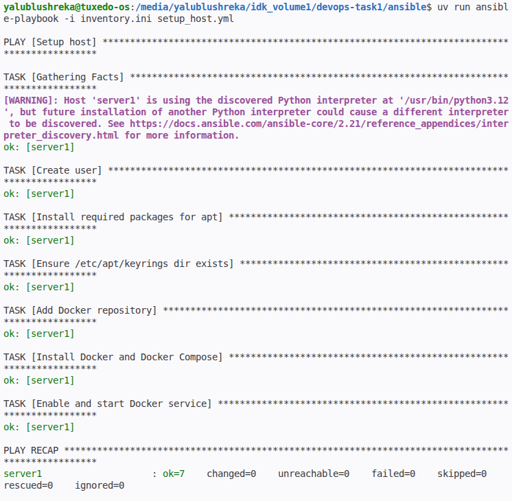
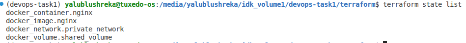
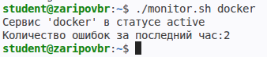
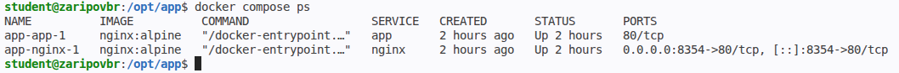
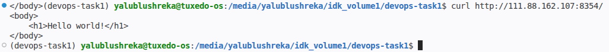

# ДЗ1 DevOps

## 1. Установка 
1. Склонируйте репозиторий: `git clone https://github.com/c0lbarator/devops-task1` и перейдите в папку репозитория  
1. Установите Terraform: [гайд](https://developer.hashicorp.com/terraform/tutorials/docker-get-started/install-cli)  
2. Установите Ansible: `pip install ansible` (лучше делайте это в виртуальном окружении)  
## 2. Запуск  
### 2.1 Ansible  
```bash
cd ansible && ansible-playbook -i inventory.ini setup_host.yml
```
### 2.2 Terraform  
```bash
cd terraform && terraform apply
```  
### 2.3 Monitor.sh  
```bash
cd scripts && chmod +x monitor.sh && ./monitor.sh <SERVICE_NAME>
```
### 2.4 Docker compose  
```bash
scp -r docker-compose-opt-app user@remote-host:/tmp/
ssh user@remote-host 'sudo mv /tmp/docker-compose-opt-app /opt/app && sudo chown -R $USER:$USER /opt/app'
ssh user@remote-host 'cd /opt/app && docker compose up -d'
curl http://remote-host:8354/
```
## 3. Принятые архитектурные решения  
**Ansible:**  
1. Подключить официальный репозиторий Docker для установки пакетов вместо репозитория Ubuntu: так на сервер будет установлена последняя версия пакетов docker, а не устаревшая  

**Monitor.sh:**  
1. Проверка существования сервиса: если systemctl is-active <SERVICE_NAME> возвращает код ошибки 4, то это означает, что сервиса не существует и об этом сообщается пользователю(чтобы он исправил опечатку)  
1. Добавить поддержку чтения логов через journalctl: на современных системах пакет syslogd отсутствует и соответственно файл /var/log/syslog с логами тоже, вместо этого используется journalctl. Если в системе всё таки есть этот файл, то логи читаются из него  

**Docker compose:**  
1. Поставить файлам конфига и веб-страницы права read only для контейнера: если в контейнере будет обнаружена уязвимость, не получится заразить систему хоста вредоносными файлами, так как контейнер не будет иметь прав на запись в проброшенные файлы  

**Terraform:**  
(не архитектурное решение скорее, а дисклеймер) .tfstate лежит в .gitignore, так как в продовых задачах там могут лежать креды  

Остальное сделано дефолтно по условию задания  

## Фоточьки  
  
*Вывод Ansible Playbook*  


  
*Вывод terraform state list*  


  
*Вывод monitor.sh*  


  
*Вывод docker compose ps*  


  
*Вывод curl*  